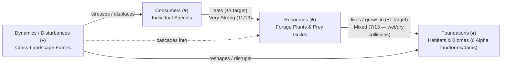

# Wildlands (Tonto Basin Alpha) — Full 52-Card Scientific Audit

Audit of **[Tearran/wildlands](https://github.com/Tearran/wildlands)** based on [`data/tonto_basin_alpha.json`](./data/tonto_basin_alpha.json) (52 cards, synced with `main` at `cfb5fdf`), [`data/cards.json`](./data/cards.json), and the design rules in [`README.md`](./README.md).

---

## 1. Executive Summary: How Well Does the Science Hold Up?

Wildlands maps a 52-card poker deck onto a **13-rank track** (`2, 3, 4, 5, 6, 7, 8, 9, 10, J, Q, K, A`) built around an ecological dependency chain (**`♥ → ♣ → ♠`**) acted upon by cross-landscape disturbances (**`♦`**):

### Design Rules Used as the Audit Baseline
To avoid misreading intentional design choices as errors, this audit evaluates the Alpha deck against the project's explicit architectural rules:

1. **Individual Species (`♥`) vs. Prey Families / Guilds (`♣`):**
   * **Consumers (`♥`)** represent **individual species** (e.g., `3♥` Desert Cottontail, `4♥` Black-tailed Jackrabbit, `2♥` Merriam's Kangaroo Rat, `6♥` Ground Squirrel).
   * **Animal Resources (`♣`)** intentionally represent **taxonomic families or prey guilds** (e.g., `K♣` *Leporidae*, `J♣` *Heteromyidae* / Seed Mice, `Q♣` *Sciuridae* / Ground Squirrels, `10♣` Desert Mice, `9♣` Lizards, `7♣` Insects). A species can therefore appear individually as a Consumer (`♥`) at low ranks and collectively within its prey family/guild (`♣`) at high ranks for predators (`Q♥`, `K♥`, `A♥`). Habitat and diet checks on `♣` are evaluated at the **guild/family level**.
2. **Primary `±1` Dependency Chain (`♥ → ♣ → ♠`):**
   * **`♥ → ♣`**: Does Consumer species $n$ eat Resources $\{n-1, n, n+1\}$?
   * **`♣ → ♠`**: Does Resource / guild $n$ live or grow in Foundation habitats $\{n-1, n, n+1\}$?
3. **Cross-Landscape Disturbances (`♠ ← ♦ → ♥` and `♣`):**
   * **Dynamics / Disturbances (`♦`)** sit on the track near habitats where they commonly act, **not** as strict $\pm1$-only locks. Under modern disturbance ecology and Southwest climate change—illustrated locally by Tonto National Forest's ~193,000-acre **2020 Bush Fire** burning across chaparral, Sonoran Desert scrub, saguaro, and riparian zones—disturbances are cross-cutting and interchangeable across the whole basin, acting *into* Foundations (`♠`), Consumers (`♥`), and Resources (`♣`). Disturbances are therefore reviewed for ecological context rather than penalized as strict $\pm1$ mismatches, and Consumers (`♥`) are **not** expected to cause weather/geologic Dynamics (`♦`).
4. **Terrestrial / Non-Fish Scope & Habitats/Biomes Foundations (`♠`):**
   * The Tonto Basin deck intentionally excludes fish (making `K♣` *Leporidae* the strongest terrestrial prey link for `A♥` Desert Bald Eagle).
   * **Foundations (`♠`)** are defined strictly as **habitats and biomes** where consumed resources live or grow (not landforms or dams); the 6 current Alpha landforms/dams (`7♠`, `8♠`, `9♠`, `10♠`, `J♠`, `A♠`) are flagged for future habitat reframing.

### Core Structural Discovery
The deck's **hidden engine is a trophic gradient running from `2` to `A` in Clubs (`♣`) and Hearts (`♥`)**:
* **Resources (`♣`)** ascend cleanly from **plant biomass** (`2–6`) → **invertebrates, eggs, small reptiles** (`7–9`) → **small-to-medium vertebrate prey guilds** (`10–A`).
* **Consumers (`♥`)** ascend cleanly from **herbivores/granivores** (`2–6`) → **omnivores, insectivores, and nest-raiders** (`7–J`) → **mesopredators and apex predators** (`Q–A`).
* **Intentional double-trophic mirroring (Species `♥` → Family/Guild `♣`):**
  * `2♥` Kangaroo Rat → `J♣` Seed Mice (*Heteromyidae*)
  * `6♥` Ground Squirrel → `Q♣` Ground Squirrels (*Sciuridae*)
  * `3♥` Cottontail & `4♥` Jackrabbit → `K♣` *Leporidae*

**Where genuine Alpha collisions still occur:** While **`♥ → ♣`** is exceptionally strong (11/13 strong), **`♣ → ♠`** currently interleaves wet riparian/reservoir Foundations (`6♠`, `9♠`, `K♠`, `A♠`) with dry upland Foundations (`2♠`, `8♠`, `Q♠`), producing two sharp exact-rank collisions (`6♠` Riparian Deciduous Forest next to xerophytic `5♣` Prickly Pear / `6♣` Jojoba Nut, and `9♠` Roosevelt Lake Dam next to terrestrial `9♣` Lizards).

### Evidence Rubric (matching [`README.md`](./README.md))
* **Consensus**: Well-established across independent published studies in the Sonoran Desert / Southwest.
* **Supported (Secondary)**: Documented in the literature, though minor, seasonal, or opportunistic.
* **Divergent**: Literature shows strong species-, site-, or condition-dependent contradictions.
* **Limited**: Sparse direct field documentation or missing local verification.
* **Mismatch**: Ecologically contradicted on that primary `♥ → ♣` or `♣ → ♠` link.

---

## 2. Complete 52-Card Roster & Scientific Identity

| Rank | Dynamics (`♦`) | Foundations (`♠`) | Resources (`♣`) | Consumers (`♥`) |
|---|---|---|---|---|
| **2** | Climate Shift *(macro-climatic forcing)* | Sonoran Desert Scrub *(Arizona Upland / Lower Colorado scrub)* | Desert Grass *(native Poaceae: Bouteloua, Pleuraphis, etc.)* | Kangaroo Rat (*Dipodomys merriami*) |
| **3** | Flash Flood *(ephemeral convective runoff)* | Semidesert Grassland *(desert-grassland ecotone)* | Bermuda Grass (*Cynodon dactylon* — **non-native**) | Cottontail (*Sylvilagus audubonii*) |
| **4** | Monsoon *(North American Monsoon, Jul–Sep)* | Mesquite Bosque (*Prosopis velutina* floodplain woodland) | Mesquite Beans (*Prosopis velutina* pods/seeds) | Jackrabbit (*Lepus californicus*) |
| **5** | Landslide *(slope failure / debris flow)* | Interior Chaparral *(evergreen sclerophyllous shrubland)* | Prickly Pear (*Opuntia engelmannii / O. phaeacantha*) | Javelina (*Pecari tajacu*) |
| **6** | Wild Fires *(unplanned vegetation combustion)* | Riparian Deciduous Forest *(Cave Creek Canyon spring oasis)* | Jojoba Nut (*Simmondsia chinensis* seeds/browse) | Ground Squirrel (*Xerospermophilus tereticaudus*) |
| **7** | Drought *(multi-season precipitation deficit)* | Open Desert Wash Systems *(ephemeral arroyos)* | Insects *(Class Insecta; 340+ invertebrate spp. at Tonto)* | Striped Skunk (*Mephitis mephitis*) |
| **8** | Population Boom *(biotic irruption)* | Desert Slope *(aspect-driven microclimate)* | Bird Eggs *(avian clutches; labeled "fowl Biomass")* | Gila Monster (*Heloderma suspectum*) |
| **9** | Desert Rain *(bimodal winter + monsoon precip.)* | Roosevelt Lake Dam *(anthropogenic reservoir, 1911)* | Lizards *(Squamata: Phrynosomatidae, Teiidae, etc.)* | Ringtail (*Bassariscus astutus*) |
| **10** | Floral Blooms *(ephemeral wildflower pulses)* | Mountain Crags *(high-elevation Mazatzal / Sierra Ancha)* | Desert Mice (*Peromyscus eremicus, P. boylii, P. maniculatus*) | Roadrunner (*Geococcyx californianus*) |
| **J** | Morning Frost *(radiative / advective freezes)* | Rocky Canyons *(incised sedimentary canyons)* | Seed Mice (*Heteromyidae*: *Chaetodipus*, *Dipodomys*) | Gray Fox (*Urocyon cinereoargenteus*) |
| **Q** | Dust Devil *(fair-weather convective vortex)* | Saguaro Cactus Forest (*Carnegiea gigantea* bajadas) | Ground Squirrels (*Sciuridae*: *Otospermophilus*, *Ammospermophilus*, *Xerospermophilus*) | Bobcat (*Lynx rufus*) |
| **K** | Dust Storm *(monsoon outflow haboob)* | Desert Riparian Scrub *(wash-bottom mesquite/acacia)* | Leporidae (*Sylvilagus audubonii*, *Lepus californicus*) | Coyote (*Canis latrans*) |
| **A** | Arundo Invasion (*Arundo donax* — **non-native**) | Diversion Dam *(managed Salt/Verde riparian corridor)* | Ground Birds (*Callipepla gambelii*, Gambel's quail) | Desert Bald Eagle (*Haliaeetus leucocephalus*) |

---

## 3. Rank-by-Rank Scientific Evaluation (`2` through `A`)

Each rank tests the two primary $\pm 1$ dependency axes plus cross-landscape disturbance context:
1. **`♥ → ♣` (Diet, `±1` window)**: Does Consumer species $n$ eat Resources $\{n-1, n, n+1\}$?
2. **`♣ → ♠` (Habitat, `±1` window)**: Does Resource / guild $n$ live or grow in Foundations $\{n-1, n, n+1\}$?
3. **`♦ → ♠ / ♥` (Cross-Landscape Disturbance Context)**: How does Dynamic $n$ act on nearby and basin-wide habitats, food webs, and wildlife?

### Rank `2` — Climate Shift (`♦`) · Sonoran Desert Scrub (`♠`) · Desert Grass (`♣`) · Kangaroo Rat (`♥`)
| Axis | Window Tested | Evidence Status | Scientific Assessment |
|---|---|---|---|
| **♥ → ♣** | `2♥` Kangaroo Rat → `2♣` Desert Grass, `3♣` Bermuda Grass | `2♣` **Consensus** · `3♣` **Mismatch** | *Dipodomys merriami* is a specialist granivore relying heavily on native desert grass and forb seeds.[^bradley1971] However, kangaroo rats require open, sparse desert ground and avoid dense sod-forming riparian turf like non-native Bermuda grass (`3♣`). |
| **♣ → ♠** | `2♣` Desert Grass → `2♠` Sonoran Scrub, `3♠` Semidesert Grassland | `2♠` **Consensus** · `3♠` **Consensus** | One of the cleanest habitat matches in the deck: native grasses (*Bouteloua*, *Pleuraphis*, *Aristida*) are diagnostic dominants in semidesert grassland (`3♠`) and key understory cover in Sonoran scrub (`2♠`).[^brown-lowe][^asdm-grasses] |
| **♦ → ♠ / ♥** | `2♦` Climate Shift *(cross-landscape)* | **Consensus** *(basin-wide)* | Macro-climatic warming and aridification shift desert-grassland boundaries (`2♠`/`3♠`), alter seed-crop reliability for granivores (`2♥`), and amplify drought and wildfire intensity across every biome in the deck. |

### Rank `3` — Flash Flood (`♦`) · Semidesert Grassland (`♠`) · Bermuda Grass (`♣`) · Cottontail (`♥`)
| Axis | Window Tested | Evidence Status | Scientific Assessment |
|---|---|---|---|
| **♥ → ♣** | `3♥` Cottontail → `2♣` Desert Grass, `3♣` Bermuda Grass, `4♣` Mesquite Beans | `2♣` **Consensus** · `3♣` **Supported** · `4♣` **Consensus** | *Sylvilagus audubonii* eats 32–51% grasses by volume in AZ/TX studies, grazes Bermuda grass where moisture supports it, and consumes mesquite pods/twigs in dry seasons.[^ecotox-cottontail] |
| **♣ → ♠** | `3♣` Bermuda Grass → `2♠` Sonoran Scrub, `3♠` Semidesert Grassland, `4♠` Mesquite Bosque | `2♠` **Mismatch** · `3♠` **Mismatch** · `4♠` **Supported** | *Cynodon dactylon* is an **introduced, moisture-dependent** warm-season sod grass. It cannot persist in dry upland desert scrub (`2♠`) or intact semidesert bunchgrass (`3♠`), though it invades moist floodplain soils beneath mesquite bosques (`4♠`). |
| **♦ → ♠ / ♥** | `3♦` Flash Flood *(cross-landscape)* | **Consensus** *(basin-wide)* | Scours and recharges floodplain **Mesquite Bosques (`4♠`)**, washes (`7♠`), and canyon corridors (`J♠`), while flooding low-lying burrows (`2♥`/`3♥`) and mobilizing debris downstream after wildfires (`6♦`). |

### Rank `4` — Monsoon (`♦`) · Mesquite Bosque (`♠`) · Mesquite Beans (`♣`) · Jackrabbit (`♥`)
| Axis | Window Tested | Evidence Status | Scientific Assessment |
|---|---|---|---|
| **♥ → ♣** | `4♥` Jackrabbit → `3♣` Bermuda Grass, `4♣` Mesquite Beans, `5♣` Prickly Pear | `3♣` **Supported** · `4♣` **Consensus** · `5♣` **Consensus** | *Lepus californicus* shifts from spring grasses to heavy browse on velvet mesquite pods/twigs (`4♣`) and prickly pear pads/fruit (`5♣`) for dry-season water and calories.[^jackrabbit-diet] |
| **♣ → ♠** | `4♣` Mesquite Beans → `3♠` Semidesert Grassland, `4♠` Mesquite Bosque, `5♠` Interior Chaparral | `3♠` **Consensus** · `4♠` **Consensus** · `5♠` **Limited** | Exact namesake match at `4♠`, plus strong overlap in `3♠` (velvet mesquite regularly occurs/encroaches in semidesert grassland). Minimal presence in higher-elevation evergreen interior chaparral (`5♠`). |
| **♦ → ♠ / ♥** | `4♦` Monsoon *(cross-landscape)* | **Consensus** *(basin-wide)* | Strong regional driver: summer monsoon fuels warm-season grasses (`3♠`), recharges alluvial water tables (`4♠`), triggers lightning fires (`5♠`), and drives summer green-up and hydration for desert herbivores (`3♥`/`4♥`) across the entire basin. |

### Rank `5` — Landslide (`♦`) · Interior Chaparral (`♠`) · Prickly Pear (`♣`) · Javelina (`♥`)
| Axis | Window Tested | Evidence Status | Scientific Assessment |
|---|---|---|---|
| **♥ → ♣** | `5♥` Javelina → `4♣` Mesquite Beans, `5♣` Prickly Pear, `6♣` Jojoba Nut | `4♣` **Consensus** · `5♣` **Consensus** · `6♣` **Divergent** *(browse vs. nut)* | **Top-tier consumer triad.** Prickly pear (`5♣`) is the #1 defining staple of Arizona *Pecari tajacu* (often 50–80% of diet, with specialized renal tolerance for oxalic acid); mesquite pods (`4♣`) are key seasonal mast.[^eddy1961] On `6♣`, Tonto/Three Bar studies confirm javelina eat jojoba **foliage/browse** (and occasionally mast), though mature seeds contain simmondsin.[^jojoba-asdm] |
| **♣ → ♠** | `5♣` Prickly Pear → `4♠` Mesquite Bosque, `5♠` Interior Chaparral, `6♠` Riparian Deciduous Forest | `4♠` **Supported** · `5♠` **Consensus** · `6♠` **Mismatch** | *Opuntia engelmannii* and *O. phaeacantha* thrive in interior chaparral (`5♠`) and bosque edges (`4♠`), but **do not grow inside shaded, permanent-water sycamore-ash-walnut riparian forest (`6♠`)**. Meanwhile, their core habitats (`2♠` Scrub, `8♠` Slope, `Q♠` Saguaro Forest) sit further away. |
| **♦ → ♠ / ♥** | `5♦` Landslide *(cross-landscape)* | **Consensus** *(steep terrain)* | Steep interior chaparral foothills (`5♠`), canyon walls (`6♠`, `J♠`), and montane slopes (`8♠`, `10♠`) experience monsoon and post-fire debris flows that reshape local cover and travel corridors. |

### Rank `6` — Wild Fires (`♦`) · Riparian Deciduous Forest (`♠`) · Jojoba Nut (`♣`) · Ground Squirrel (`♥`)
| Axis | Window Tested | Evidence Status | Scientific Assessment |
|---|---|---|---|
| **♥ → ♣** | `6♥` Ground Squirrel → `5♣` Prickly Pear, `6♣` Jojoba Nut, `7♣` Insects | `5♣` **Supported** · `6♣` **Divergent / Mismatch** · `7♣` **Consensus** | **Key chemical-ecology catch.** *Xerospermophilus tereticaudus* eats ~80% high-moisture green shoots/succulents (including cactus pulp `5♣`), ~15% seeds, and ~5–15% insects (`7♣`). However, **jojoba seeds (`6♣`) contain simmondsin and liquid wax esters** that deter or cause severe weight loss in nearly all rodents—**Bailey's pocket mouse (*Chaetodipus baileyi*) is the famous specialist exception** (`J♣` *Heteromyidae*), NOT round-tailed ground squirrels.[^sherbrooke1976] |
| **♣ → ♠** | `6♣` Jojoba Nut → `5♠` Interior Chaparral, `6♠` Riparian Deciduous Forest, `7♠` Open Desert Wash | `5♠` **Consensus** · `6♠` **Mismatch** · `7♠` **Consensus** | **Sharpest exact-rank habitat collision in the deck.** Jojoba (*Simmondsia chinensis*) is a xerophytic shrub of rocky bajadas, lower chaparral (`5♠`), and wash margins (`7♠`)—its own card text places it in *Sonoran Desert scrub*, directly contradicting permanent-water deciduous forest at `6♠`. |
| **♦ → ♠ / ♥** | `6♦` Wild Fires *(cross-landscape)* | **Consensus** *(basin-wide under climate change)* | Classic crown-fire driver in interior chaparral (`5♠`), and under modern drought/invasive-grass fuel loads (e.g., Tonto National Forest's 2020 Bush Fire), wildfire jumps across Sonoran Desert scrub (`2♠`), saguaro stands (`Q♠`), and riparian canyons (`6♠`, `K♠`), destroying prickly pear stands and thermal cover for javelina (`5♥`) and desert fauna. |

### Rank `7` — Drought (`♦`) · Open Desert Wash Systems (`♠`) · Insects (`♣`) · Striped Skunk (`♥`)
| Axis | Window Tested | Evidence Status | Scientific Assessment |
|---|---|---|---|
| **♥ → ♣** | `7♥` Striped Skunk → `6♣` Jojoba Nut, `7♣` Insects, `8♣` Bird Eggs | `6♣` **Mismatch** · `7♣` **Consensus** · `8♣` **Consensus** | Insects (`7♣`, 50–70%+ of diet) and ground-nesting bird eggs (`8♣`) are textbook striped skunk foods.[^adw-skunk] Skunks do not consume toxic jojoba seeds (`6♣`). *(Note: `7♥`'s card text oddly omits insects altogether!)* |
| **♣ → ♠** | `7♣` Insects → `6♠` Riparian Forest, `7♠` Open Desert Wash, `8♠` Desert Slope | **Consensus** *(all 3)* | High terrestrial arthropod diversity across all three foundations (especially riparian woodland and washes), cleanly matching `7♣` as a broad prey guild. |
| **♦ → ♠ / ♥** | `7♦` Drought *(cross-landscape)* | **Consensus** *(basin-wide)* | Basin-wide stressor: dewaters spring-fed riparian forest (`6♠`), suppresses wash vegetation (`7♠`) and slope forage (`8♠`), triggers summer **aestivation** in round-tailed ground squirrels (`6♥`),[^adw-rtgs] and concentrates striped skunks (`7♥`) along watered drainages. |

### Rank `8` — Population Boom (`♦`) · Desert Slope (`♠`) · Bird Eggs (`♣`) · Gila Monster (`♥`)
| Axis | Window Tested | Evidence Status | Scientific Assessment |
|---|---|---|---|
| **♥ → ♣** | `8♥` Gila Monster → `7♣` Insects, `8♣` Bird Eggs, `9♣` Lizards | `7♣` **Limited/Rare** · `8♣` **Consensus** · `9♣` **Divergent** | **Exact match `8♥ = 8♣` is textbook**: *Heloderma suspectum* is a specialized nest-raider of ground-nesting bird eggs (`8♣`), reptile eggs, and neonate mammals.[^beck2005] Adult active lizards (`9♣`) and insects (`7♣`) are rare/incidental—the reptile component of its diet is predominantly **reptile eggs**, not fast-moving adult lizards. |
| **♣ → ♠** | `8♣` Bird Eggs → `7♠` Open Desert Wash, `8♠` Desert Slope, `9♠` Roosevelt Lake Dam | `7♠` **Consensus** · `8♠` **Consensus** · `9♠` **Supported** | Washes (`7♠`) and desert slopes (`8♠`) host abundant ground- and shrub-nesting birds (quail, doves, thrashers, cactus wrens). Lake Roosevelt's riparian shoreline (`9♠`) hosts marsh/riparian nesters (including Southwestern Willow Flycatcher), though not the concrete dam itself. |
| **♦ → ♠ / ♥** | `8♦` Population Boom *(cross-landscape)* | **Consensus** *(biotic pulse)* | Wet-year rodent, insect, and nesting booms cascade upward across the entire food web—allowing slow-reproducing nest-raiders (`8♥` Gila Monster) and nocturnal predators (`9♥` Ringtail through `K♥` Coyote) to capitalize on abundant prey (`7♣–K♣`). |

### Rank `9` — Desert Rain (`♦`) · Roosevelt Lake Dam (`♠`) · Lizards (`♣`) · Ringtail (`♥`)
| Axis | Window Tested | Evidence Status | Scientific Assessment |
|---|---|---|---|
| **♥ → ♣** | `9♥` Ringtail → `8♣` Bird Eggs, `9♣` Lizards, `10♣` Desert Mice | `8♣` **Supported** · `9♣` **Consensus** · `10♣` **Consensus** | *Bassariscus astutus* is a nocturnal canyon omnivore-predator taking *Peromyscus* mice (`10♣`), crevice lizards (`9♣`), and raided bird nests/eggs (`8♣`), alongside insects (`7♣`) and canyon fruits (hackberry/prickly pear).[^adw-ringtail] |
| **♣ → ♠** | `9♣` Lizards → `8♠` Desert Slope, `9♠` Roosevelt Lake Dam, `10♠` Mountain Crags | `8♠` **Consensus** · `9♠` **Mismatch** · `10♠` **Supported** | **Major exact-rank dislocation.** Sun-warmed rocky slopes (`8♠`) and lower rocky crags (`10♠`) are classic lizard habitats, but **Roosevelt Lake Dam (`9♠`)** is an anthropogenic reservoir—an aquatic/dam card paired with terrestrial lizards (`9♣`) and a dry-canyon climber (`9♥`). |
| **♦ → ♠ / ♥** | `9♦` Desert Rain *(cross-landscape)* | **Consensus** *(basin-wide)* | Bimodal winter + monsoon precipitation drives orographic runoff on Mazatzal/Sierra Ancha slopes (`8♠`, `10♠`), governs Lake Roosevelt inflows (`9♠`), and directly triggers Gila Monster (`8♥`) surface foraging activity. |

### Rank `10` — Floral Blooms (`♦`) · Mountain Crags (`♠`) · Desert Mice (`♣`) · Roadrunner (`♥`)
| Axis | Window Tested | Evidence Status | Scientific Assessment |
|---|---|---|---|
| **♥ → ♣** | `10♥` Roadrunner → `9♣` Lizards, `10♣` Desert Mice, `J♣` Seed Mice | **Consensus** *(all 3)* | **Textbook predator-prey triad.** *Geococcyx californianus* relies heavily on lizards (`9♣`) plus snakes, large insects, *Peromyscus* mice (`10♣`), and heteromyid rodents (`J♣`).[^adw-roadrunner] |
| **♣ → ♠** | `10♣` Desert Mice (*Peromyscus* guild) → `9♠` Roosevelt Lake Dam, `10♠` Mountain Crags, `J♠` Rocky Canyons | `9♠` **Weak** · `10♠` **Consensus** · `J♠` **Consensus** | Brush mice (*P. boylii*), cactus mice (*P. eremicus*), and deer mice (*P. maniculatus*) are dominant rodents of rocky canyons (`J♠`) and montane crags (`10♠`); weak connection to an aquatic reservoir (`9♠`). |
| **♦ → ♠ / ♥** | `10♦` Floral Blooms *(cross-landscape)* | **Consensus** *(low-desert pulse)* | Wet-winter annual wildflower pulses erupt primarily across low desert basins and bajadas (`2♠`, `8♠`, `Q♠`) rather than high barren crags (`10♠`), fueling insect (`7♣`) and seed/rodent pulses across the food web. |

### Rank `J` — Morning Frost (`♦`) · Rocky Canyons (`♠`) · Seed Mice (`♣`) · Gray Fox (`♥`)
| Axis | Window Tested | Evidence Status | Scientific Assessment |
|---|---|---|---|
| **♥ → ♣** | `J♥` Gray Fox → `10♣` Desert Mice, `J♣` Seed Mice, `Q♣` Ground Squirrels | **Consensus** *(all 3)* | **Textbook triad.** *Urocyon cinereoargenteus* preys across *Peromyscus* (`10♣`), heteromyids (`J♣`), and rock/antelope ground squirrels (`Q♣`), supplemented heavily by desert fruits (hackberry, juniper, prickly pear) and lagomorphs.[^usda-grayfox] |
| **♣ → ♠** | `J♣` Seed Mice (*Heteromyidae* guild) → `10♠` Mountain Crags, `J♠` Rocky Canyons, `Q♠` Saguaro Cactus Forest | `10♠` **Mismatch** · `J♠` **Consensus** *(guild-level)* · `Q♠` **Consensus** | Evaluated at the **family/guild level**: *Heteromyidae* spans both **Saguaro bajadas (`Q♠`)** (Bailey's pocket mouse *Chaetodipus baileyi* and kangaroo rats *Dipodomys*) AND **Rocky Canyons (`J♠`)** (Rock pocket mouse *Chaetodipus intermedius*). However, heteromyids are low-to-mid-elevation desert rodents that do not occupy high montane crags (`10♠`). |
| **♦ → ♠ / ♥** | `J♦` Morning Frost *(cross-landscape)* | **Consensus** *(standout link)* | Cold-air drainage in canyons (`J♠`), freezing high elevations (`10♠`), and catastrophic freeze boundaries on **Saguaro Cactus Forests (`Q♠`)** are landmark Sonoran Desert bioclimatology (Steenbergh & Lowe 1977),[^steenbergh1977] while Roadrunners (`10♥`) survive freezing desert mornings via nocturnal hypothermia and black-skin solar basking (Ohmart & Lasiewski 1971).[^ohmart1971] |

### Rank `Q` — Dust Devil (`♦`) · Saguaro Cactus Forest (`♠`) · Ground Squirrels (`♣`) · Bobcat (`♥`)
| Axis | Window Tested | Evidence Status | Scientific Assessment |
|---|---|---|---|
| **♥ → ♣** | `Q♥` Bobcat → `J♣` Seed Mice, `Q♣` Ground Squirrels, `K♣` Leporidae | **Consensus** *(all 3)* | **Textbook triad.** Central Arizona diet studies confirm *Lynx rufus* depends on rodents (heteromyids `J♣`, woodrats, ground squirrels `Q♣`) and lagomorphs (`K♣`).[^mckinney2007] |
| **♣ → ♠** | `Q♣` Ground Squirrels (*Sciuridae* guild) → `J♠` Rocky Canyons, `Q♠` Saguaro Cactus Forest, `K♠` Desert Riparian Scrub | **Consensus** *(all 3)* | **Excellent guild-level fit**: rock squirrels (*Otospermophilus variegatus*) dominate `J♠` and `K♠`, while Harris's antelope squirrels (*Ammospermophilus harrisii*) and round-tailed ground squirrels (*X. tereticaudus*) occupy `Q♠` and desert basins. |
| **♦ → ♠ / ♥** | `Q♦` Dust Devil *(cross-landscape)* | **Consensus** *(heated open basins)* | Convective thermals form over sun-baked low desert basins (`2♠`, `3♠`, `Q♠`), redistributing fine desert dust and seeds across open flats. |

### Rank `K` — Dust Storm (`♦`) · Desert Riparian Scrub (`♠`) · Leporidae (`♣`) · Coyote (`♥`)
| Axis | Window Tested | Evidence Status | Scientific Assessment |
|---|---|---|---|
| **♥ → ♣** | `K♥` Coyote → `Q♣` Ground Squirrels, `K♣` Leporidae, `A♣` Ground Birds | `Q♣` **Consensus** · `K♣` **Consensus** · `A♣` **Supported** | *Canis latrans* is the premier predator of lagomorphs (`K♣`, more so than bobcats in central AZ) and ground squirrels (`Q♣`), and opportunistically takes Gambel's quail (`A♣`) alongside cactus/mesquite fruit and carrion.[^mckinney2007] |
| **♣ → ♠** | `K♣` Leporidae *(rabbits & hares guild)* → `Q♠` Saguaro Cactus Forest, `K♠` Desert Riparian Scrub, `A♠` Diversion Dam | `Q♠` **Consensus** · `K♠` **Consensus** · `A♠` **Weak** | Evaluated at the **family level**: both desert cottontails and black-tailed jackrabbits thrive across saguaro bajadas (`Q♠`), and cottontails depend heavily on dense desert riparian scrub (`K♠`). Minimal direct coupling to a concrete diversion dam (`A♠`). |
| **♦ → ♠ / ♥** | `K♦` Dust Storm *(cross-landscape)* | **Consensus** *(basin-wide)* | Monsoon outflow storms/haboobs sweep low desert basins (`2♠`, `Q♠`, toppling old saguaros and redistributing eolian dust) and deposit dust trapped by riparian scrub canopies (`K♠`), temporarily forcing desert wildlife to shelter. |

### Rank `A` — Arundo Invasion (`♦`) · Diversion Dam (`♠`) · Ground Birds (`♣`) · Desert Bald Eagle (`♥`)
| Axis | Window Tested | Evidence Status | Scientific Assessment |
|---|---|---|---|
| **♥ → ♣** | `A♥` Desert Bald Eagle → `K♣` Leporidae, `A♣` Ground Birds (Gambel's Quail) | `K♣` **Consensus** *(secondary / seasonal staple)* · `A♣` **Supported (Minor)** | Grubb (1995, Table 1) recorded 1,471 identified prey items across 14 central Arizona nests: **76% fish (1,118)**, **18% mammals (263)**, **4% birds (59)**, and **2% reptiles/amphibians (31)**.[^grubb1995] Crucially, **Leporidae dominated mammals identified below class (71 of 105 = 67.6%: 50 desert cottontails, 7 black-tailed jackrabbits, 14 unidentified lagomorphs)**. Across all mammals combined, **mammalian prey** rose to **28% of total prey in February** (turbid spring runoff) and reached **30%–49% at Salt River/Tonto-area sites** (`76` and `Pinal`). Birds totaled 4%–12% across Arizona studies (22 waterfowl + 37 other birds in Grubb 1995, with **Gambel's Quail** explicitly confirmed in Table 1 footnote *d*). Within the deck's **no-fish terrestrial constraint**, `K♣ Leporidae` is the #1 scientifically supported prey link for `A♥`, while `A♣` is accurate as a minor/opportunistic link (broadening `A♣` to include waterfowl would strengthen the aquatic-bird tie without adding fish). |
| **♣ → ♠** | `A♣` Ground Birds (Gambel's Quail) → `K♠` Desert Riparian Scrub, `A♠` Diversion Dam | `K♠` **Consensus** · `A♠` **Weak / Mismatch** | *Callipepla gambelii* relies heavily on desert riparian scrub (`K♠`, mesquite/catclaw washes) for shade, roosting, and moisture, but is an arid-scrub terrestrial gamebird rather than an aquatic diversion-dam bird. |
| **♦ → ♠ / ♥** | `A♦` Arundo Invasion *(cross-landscape riparian)* | **Consensus** *(10/10 Salt & Verde realism)* | Giant reed (*Arundo donax*) explosively colonizes flow-altered riverbanks below diversion dams (`A♠`), displaces native riparian scrub (`K♠`) and woodland (`6♠`), chokes cottonwood-willow nest/perch trees for Bald Eagles (`A♥`), and fuels intense riparian wildfires (`6♦`). |

---

## 4. Suit-Level Scientific, Taxonomic & Data Integrity Findings

> [!WARNING]
> Beyond the `♥ → ♣ → ♠` rank checks above, six concrete scientific or data-hygiene items appear inside the current Alpha card files ([`data/tonto_basin_alpha.json`](./data/tonto_basin_alpha.json) and [`data/cards.json`](./data/cards.json)).

1. **Non-Native Species Split Across Suits (`3♣` vs. `A♦`)**
   * **Bermuda Grass (`3♣`, *Cynodon dactylon*)** is an **introduced, invasive Eurasian/African grass** treated as a standard Resource (`♣`), while **Arundo Invasion (`A♦`, *Arundo donax*)** is another introduced invasive riparian grass treated as a Dynamic (`♦`). Replacing `3♣` with a native forage guild (e.g., **Desert Forbs / Globemallow** or **Saltbush / Shrub Browse**) keeps all `♣` cards native AND upgrades `2♠`/`3♠` habitat compatibility from Mismatch to Consensus.
2. **Jojoba Toxicity Inaccuracy (`6♣`)**
   * `6♣ Jojoba Nut` claims *"Its nuts are eaten by ground squirrels, mice, rabbits, birds, and other mammals."* Scientifically, mature jojoba seeds contain **simmondsin** and liquid wax esters toxic/deterrent to most rodents; **Bailey's pocket mouse (*Chaetodipus baileyi*)** is the iconic specialist consumer, while mule deer and javelina mainly browse jojoba **foliage/twigs**.[^sherbrooke1976]
3. **Missing Primary Diet on Card Text (`7♥` Striped Skunk)**
   * `7♥`'s fact text says *"eat seeds, roots, berries, and small mammals"*, completely omitting **insects** (its #1 food and its exact rank partner `7♣`) and **bird eggs** (`8♣`).
4. **Local Biogeography Nuance (`6♥` Round-tailed Ground Squirrel)**
   * `6♥` uses `consumers_round_tailed_ground_squirrel.svg` (*Xerospermophilus tereticaudus*), which favors low, flat sandy desert basins. On the rocky slopes of Tonto National Monument itself, **Harris's antelope squirrel (*Ammospermophilus harrisii*)** and **Rock squirrel (*Otospermophilus variegatus*)** are the primary resident ground squirrels (though *X. tereticaudus* occurs in lower sandy Arizona desert basins).
5. **Foundations (`♠`) Landforms/Dams vs. Habitats/Biomes**
   * **Foundations (`♠`)** are intended to represent **habitats and biomes** where consumed resources live or grow—not abiotic landforms or man-made dams. Currently the Alpha suit mixes 7 true biotic communities (`2♠–6♠`, `Q♠`, `K♠`) with 4 landforms (`7♠`, `8♠`, `10♠`, `J♠`) and 2 dams (`9♠`, `A♠`). Reframing those 6 slots as true Tonto Basin habitats/biomes (e.g., *Desert Wash Woodland*, *Arizona Upland Foothill Scrub*, *Reservoir Shoreline Marsh*, *Pinyon-Juniper Woodland*, *Canyon Woodland*, *Cottonwood-Willow Gallery Forest*) will unify the entire suit cleanly.
6. **JSON Copy & Asset Hygiene Notes**
   * **Display-name consistency (style note, not a scientific error):** Animal Resources (`7♣–A♣`) intentionally represent taxonomic families/guilds—so `K♣ Leporidae` is scientifically spot-on. For visual consistency across cards, you may optionally use common names in `card_primary_name` (e.g., `"Rabbits & Hares"`) and put the Latin family (`"Leporidae"`) in `card_secondary_name`, and change `8♣` `"fowl Biomass"` to `"Avian Biomass"`. Only 4 of 13 Consumers currently list Latin binomials in `card_secondary_name` (`3♥`, `J♥`, `Q♥`, `K♥`).
   * **Data & file defects:** `2♠ Sonoran Desert Scrub` has empty `fact_paragraph` and `abilities_paragraph` in both JSON files (only the line-split fields are populated); `9♣ Lizards` has an empty `card_primary_name` in [`data/cards.json`](./data/cards.json); `2♦ Climate Shift` and `7♦ Drought` share the same SVG (`disturbances_mega_drought.svg`) while `disturbances_extreme_heat.svg` and `foundations_desert_senna.svg` go unused; `10♦ Floral Blooms` references misspelled `assets/svg/disterbances_bloom.svg` even though `disturbances_bloom.svg` exists.

---

## 5. High-Impact Scientific Realignment Opportunities

Without redesigning the 52-card system (and honoring the **no-fish** constraint, **Species `♥` vs. Guild `♣`** split, **Cross-Landscape `♦` Disturbances**, and **habitats/biomes-only Foundations** rule), **5 targeted moves** would make the Alpha deck nearly spotless:

| Priority | Current Issue | Suggested Scientific Fix | Ecological Gain |
|---|---|---|---|
| **1 (Highest)** | **Foundations (`♠`)** currently include 4 landforms (`7♠`, `8♠`, `10♠`, `J♠`) and 2 dams (`9♠`, `A♠`), and wet/dry habitats collide (`6♠` Riparian Forest vs. `5♣/6♣` Cactus/Jojoba; `9♠` Dam vs. `9♣` Lizards). | Reframe all 13 `♠` cards strictly as **habitats/biomes**, cluster the **riparian/wetland biomes** together (e.g., `K♠–A♠`), and place **xerophytic upland scrub/bajada habitats** in the `5♠–6♠` cactus/jojoba band. | Aligns every `♠` card to the habitats/biomes rule and fixes the deck's two worst exact-rank habitat collisions (`6♠`/`6♣` and `9♠`/`9♣`) simultaneously. |
| **2 (High)** | Under the **no-fish constraint**, `K♣ Leporidae` is a proven Bald Eagle secondary/seasonal staple (`67.6%` of mammals identified below class in Grubb 1995), while `A♣` **Gambel's Quail** is only a minor prey item and mismatches riparian `A♠`. | Keep `K♣ Leporidae` adjacent to `A♥`, and optionally broaden `A♣` to **Waterfowl & Ground Birds** (e.g., *Coots, Ducks & Quail*)—still zero fish, while matching Grubb (1995)'s avian records and riparian `A♠`. | Aligns `A♥` Desert Bald Eagle → `A♣` Waterfowl/Birds → `A♠` Riparian Corridor cleanly without adding fish. |
| **3 (High)** | `3♣` Bermuda Grass is **non-native** and fails in dry `2♠`/`3♠` habitats. | Swap `3♣` to a native forage guild (e.g., **Desert Forbs / Wildflowers** or **Saltbush / Shrub Browse**). | Keeps all `♣` resources native and aligns `2♥/3♥/4♥` → `3♣` → `2♠/3♠`. |
| **4 (Medium)** | `6♣` Jojoba Nut toxicity copy contradicts `6♥` Ground Squirrel and `7♥` Striped Skunk. | Either (a) reframe `6♣` as **Desert Shrub Browse / Catclaw & Jojoba** (accurately reflecting javelina/deer browse + Bailey's pocket mouse seed specialist) or (b) swap `6♣` to **Desert Seeds / Cactus Fruit** while pairing Jojoba near `J♣` (*Heteromyidae* / Bailey's pocket mouse). | Aligns chemical ecology with Sherbrooke (1976) and removes the skunk–jojoba mismatch. |
| **5 (Easy Text Fix)** | `7♥` Striped Skunk omits insects; `8♣` says `"fowl Biomass"`; `2♠` missing paragraph fields; `10♦` SVG filename typo (`disterbances_bloom.svg`). | Update card copy & JSON consistency in [`data/tonto_basin_alpha.json`](./data/tonto_basin_alpha.json) and sync [`data/cards.json`](./data/cards.json). | Immediate scientific accuracy and data-hygiene upgrade with zero mechanical change. |

---

## 6. Key Scientific References

[^bradley1971]: Bradley, W. G. & Mauer, R. A. (1971). Reproduction and food habits of Merriam's kangaroo rat, *Dipodomys merriami*. *Journal of Mammalogy* 52(3): 497–507.
[^brown-lowe]: Brown, D. E. & Lowe, C. H. (1980 / 1994). *Biotic Communities: Southwestern United States and Northwestern Mexico*. University of Utah Press.
[^asdm-grasses]: Van Devender, T. R. & Dimmitt, M. A. "Desert Grasses." *A Natural History of the Sonoran Desert*, Arizona-Sonora Desert Museum.
[^ecotox-cottontail]: Turkowski, F. J. (1975). Dietary adaptability of the desert cottontail (*Sylvilagus audubonii*). *Journal of Wildlife Management* 39(4): 748–756.
[^jackrabbit-diet]: Hayden, P. (1966) & Arizona-Sonora Desert Museum species account for Black-tailed Jackrabbit (*Lepus californicus*); USDA Forest Service FEIS (*Lepus californicus*).
[^eddy1961]: Eddy, T. A. (1961). Foods and feeding patterns of the collared peccary in southern Arizona. *Journal of Wildlife Management* 25(3): 248–257; Three Bar Wildlife Area / Tonto National Forest peccary forage studies.
[^jojoba-asdm]: Arizona-Sonora Desert Museum & USDA Forest Service FEIS accounts for Jojoba (*Simmondsia chinensis*).
[^sherbrooke1976]: Sherbrooke, W. C. (1976). Differential acceptance of toxic jojoba seed (*Simmondsia chinensis*) by four Sonoran Desert heteromyid rodents. *Ecology* 57(3): 596–602.
[^adw-rtgs]: Ernest, K. A. & Mares, M. A. (1987). *Spermophilus tereticaudus*. *Mammalian Species* 274: 1–9; Animal Diversity Web (*Xerospermophilus tereticaudus*).
[^adw-skunk]: Wade-Smith, J. & Verts, B. J. (1982). *Mephitis mephitis*. *Mammalian Species* 173: 1–7; Animal Diversity Web.
[^beck2005]: Beck, D. D. (2005). *Biology of Gila Monsters and Beaded Lizards*. University of California Press.
[^adw-ringtail]: Poglayen-Neuwall, I. & Toweill, D. E. (1988). *Bassariscus astutus*. *Mammalian Species* 327: 1–8; Trapp, G. R. (1978), comparative behavioral ecology of the ringtail and gray fox.
[^adw-roadrunner]: Hughes, J. M. (1996). Greater Roadrunner (*Geococcyx californianus*). *Birds of the World*, Cornell Lab of Ornithology.
[^ohmart1971]: Ohmart, R. D. & Lasiewski, R. C. (1971). Roadrunners: Energy conservation by hypothermia and absorption of sunlight. *Science* 172(3978): 67–69.
[^usda-grayfox]: Fritzell, E. K. & Haroldson, K. J. (1982). *Urocyon cinereoargenteus*. *Mammalian Species* 189: 1–8; USDA FEIS.
[^steenbergh1977]: Steenbergh, W. F. & Lowe, C. H. (1977). *Ecology of the Saguaro: II. Reproduction, Germination, Establishment, Growth, and Survival of the Young Plant*. National Park Service Scientific Monograph Series No. 8.
[^mckinney2007]: McKinney, T. & Smith, T. W. (2007). Diets of sympatric bobcats and coyotes during years of varying rainfall in central Arizona. *Western North American Naturalist* 67(1): 8–15.
[^grubb1995]: Grubb, T. G. (1995). Food habits of Bald Eagles breeding in the Arizona desert. *The Wilson Bulletin* 107(2): 258–274.
